<p align="center">
  
</p>

<h1 align="center">Murmur</h1>

<p align="center">
  <strong>Hold a key. Speak. Release. The words appear at your cursor.</strong><br>
  Free, open-source push-to-talk dictation for Windows. 100% local — no account, no cloud, no telemetry.
</p>

<p align="center">
  <a href="https://github.com/RidhivSharma/RedFlow/releases/latest"></a>
  
  
  
</p>

Murmur is a tiny tray app that turns your voice into text in any Windows app. Click into a text field, hold **F9**, speak normally, and release. Murmur records the microphone, transcribes the utterance locally with [whisper.cpp](https://github.com/ggml-org/whisper.cpp), and pastes the result at the caret.

No browser tab. No account. No subscription. No audio leaving your PC.

<p align="center">
  <a href="#how-it-works">How it works</a> ·
  <a href="#install">Install</a> ·
  <a href="#usage">Usage</a> ·
  <a href="#settings">Settings</a> ·
  <a href="#privacy-and-security">Privacy</a> ·
  <a href="#troubleshooting">Troubleshooting</a> ·
  <a href="#build-from-source">Build</a>
</p>

**At a glance**

- **Platform:** Windows 10 or 11, x64
- **Engine:** whisper.cpp on your CPU
- **Default model:** `ggml-base.en.bin` (English)
- **Activation:** Hold `F9` anywhere, or rebind it
- **License:** MIT

### Why Murmur

- **Local by design.** The speech engine, the model, and every recording stay on your machine. The installed app makes no network requests.
- **Works where you type.** Notepad, VS Code, Chrome, Word, chat apps, terminals — anything that accepts a paste.
- **Fast enough to disappear.** The microphone stays warm, so pressing the key does not wait for the device to open and clip the first word.
- **Open and inspectable.** Small TypeScript codebase, strict types, documented architecture, MIT license.

---

## How it works

```
   HOLD F9              CAPTURE                  TRANSCRIBE                 INSERT
  ┌─────────┐   ───▶   ┌───────────────┐   ───▶   ┌────────────────┐   ───▶   ┌───────────┐
  │  speak  │          │  16 kHz mono  │          │  whisper.cpp   │          │   Ctrl+V  │
  │ release │          │  16-bit WAV   │          │   on your CPU  │          │ at cursor │
  └─────────┘          └───────────────┘          └────────────────┘          └───────────┘
```

1. **Hold** — a global hook watches for your push-to-talk binding. Nothing else is recorded or logged.
2. **Capture** — a hidden renderer writes the held audio as 16 kHz, mono, 16-bit PCM. The overlay shows a live level meter.
3. **Transcribe** — one local `whisper-cli.exe` process per utterance, run through a FIFO queue. Near-silent holds are skipped instead of letting Whisper invent text.
4. **Insert** — Murmur saves the clipboard, writes the transcript, sends Ctrl+V, then restores the previous clipboard. The overlay confirms **Inserted**.

Overlapping holds are queued and inserted in order. Holds shorter than 300 ms are treated as taps and ignored; one hold is capped at 120 seconds.

---

## Install

1. Download **`Murmur-Setup-<version>.exe`** from the [latest release](https://github.com/RidhivSharma/RedFlow/releases/latest).
2. Optionally verify the SHA-256 checksum published with the release.
3. Run the installer. It is per-user, needs no administrator rights, and creates Start Menu and desktop shortcuts.
4. Launch Murmur. It starts in the system tray and does not open a main window.

On first launch, allow desktop apps to use the microphone: **Settings → Privacy & security → Microphone → Let desktop apps access your microphone**. On Windows 10 the path is **Settings → Privacy → Microphone**.

<details>
<summary><strong>SmartScreen, antivirus, and checksums</strong></summary>

Murmur's installer is not code-signed. Windows SmartScreen may show **“Windows protected your PC”** the first time you run it. This is expected for an unsigned open-source app; it is not a malware report. Click **More info → Run anyway**, or build from source if you prefer.

Some antivirus engines treat global keyboard hooks, clipboard access, and simulated Ctrl+V as suspicious because those are also techniques used by malware. Murmur uses them openly, for the features described in this README.

Verify the download before running it:

```powershell
$file = Get-ChildItem .\Murmur-Setup-*.exe
Get-FileHash $file -Algorithm SHA256
```

Compare the output with the `.sha256` value on the release page. If they differ, do not run the file. Never disable antivirus protection system-wide to install any app.

</details>

---

## Usage

1. Click into the text field where you want the text to go.
2. Hold **F9** anywhere in Windows.
3. Speak normally, then release.
4. Watch the pill at the bottom of the screen: **Listening → Transcribing → Inserted**. The text is pasted at the caret.

Keep the target app focused until the pill says **Inserted**. Murmur pastes into whatever window has focus when the transcript is ready, not necessarily the window that was focused when you pressed the key.

**Tips**

- Holds shorter than 300 ms are ignored as taps.
- A single hold is capped at 120 seconds; Murmur transcribes what it has.
- You can start another utterance while the previous one is still transcribing. Utterances are queued and inserted in order.
- The tray tooltip shows the current state. The tray menu has **Settings** and **Quit**; double-clicking the icon also opens Settings.
- Murmur never pastes into its own windows. If Settings has focus when a transcript is ready, insertion is refused instead of typing into the settings UI.

### Pasting into administrator apps (UIPI)

Windows blocks simulated input from a normal user-level app into an app running as administrator (UIPI — User Interface Privilege Isolation). Murmur checks the foreground app before inserting. If the target is elevated or its integrity cannot be checked, Murmur does **not** send Ctrl+V. It copies the transcript to the clipboard, leaves it there, and shows **Copied** in the overlay.

Press Ctrl+V yourself in the target app. The previous clipboard is intentionally not restored in this case, so the transcript stays available for the manual paste. Running Murmur as administrator can let it paste into some elevated apps, but it is not recommended: it gives Murmur more privilege than it needs. UIPI is a Windows security boundary, not a Murmur bug.

---

## Settings

Open the tray menu and choose **Settings**, or double-click the tray icon. Changes save automatically and apply without restarting Murmur.

| Setting                 | What it does                                                                                                                                                        |
| :---------------------- | :------------------------------------------------------------------------------------------------------------------------------------------------------------------ |
| **Push-to-talk hotkey** | Click the picker, then press the key or combination you want to hold. `Escape` cancels. Bare keys such as `F9` and combinations such as `Ctrl+Space` are supported. |
| **Trailing space**      | Adds one space after each transcript so back-to-back dictations do not run together.                                                                                |
| **Remove filler words** | Drops sounds such as “um” and “uh” from the transcript.                                                                                                             |
| **Spoken commands**     | Turns “new line”, “new paragraph”, “period”, “comma”, and “question mark” into punctuation and line breaks.                                                         |
| **Input device**        | Chooses the microphone. **System default** follows the device Windows currently uses.                                                                               |
| **Test microphone**     | Shows a live level meter for the selected input.                                                                                                                    |
| **Whisper model**       | Lists the `.bin` files in Murmur's models folder. The bundled default is `ggml-base.en.bin`.                                                                        |
| **Language**            | **English** or **Auto-detect**. Auto-detect needs a multilingual model; `base.en` is English-only.                                                                  |
| **Start with Windows**  | Launches Murmur quietly in the tray when you sign in.                                                                                                               |

Settings live in `%APPDATA%\Murmur\settings.json`. The settings window is the supported way to change them; if you edit the file by hand, quit Murmur first and restart it afterwards.

<details>
<summary><strong>Advanced settings</strong></summary>

A few options are intentionally not exposed in the settings window. Change them in `settings.json` while Murmur is closed:

| Key                   | Default  | Meaning                                                                                          |
| :-------------------- | :------- | :----------------------------------------------------------------------------------------------- |
| `threads`             | `0`      | Whisper thread count. `0` means auto (logical cores minus one, minimum two).                     |
| `pasteRestoreDelayMs` | `350`    | How long the target app gets to read the clipboard before Murmur restores the previous contents. |
| `minUtteranceMs`      | `300`    | Holds shorter than this are discarded as taps.                                                   |
| `maxUtteranceMs`      | `120000` | Hard cap for one utterance. The recorder also enforces a 120 s maximum.                          |

</details>

---

## Privacy and security

**All speech processing is local.** Murmur does not send audio, transcripts, or usage data anywhere.

- Audio is captured by a hidden renderer window and transcribed locally by `whisper-cli.exe` on your CPU.
- There are no accounts, API keys, cloud APIs, telemetry, analytics, or update checks. The installed app makes no network requests.
- The microphone stream stays open between utterances so the first word is not clipped. Audio samples are only buffered while the hotkey is held; that is why Windows may show the microphone-in-use indicator for as long as Murmur runs.
- The latest utterance is written to `%TEMP%\murmur\last.wav` for troubleshooting and is replaced by the next one. Queued utterances get temporary copies that are deleted after transcription. Delete `%TEMP%\murmur` to remove the remaining audio.
- Logs are written to `%APPDATA%\Murmur\logs\murmur.log` and never contain audio. Transcript text is not logged by default. Set `MURMUR_DEBUG=1` before launch to include transcripts in the log while troubleshooting; turn it off afterwards.
- To insert text, Murmur reads the current clipboard text, writes the transcript, sends Ctrl+V, and restores the previous clipboard after a short delay (350 ms by default). Clipboard-history tools may still record the transcript. Elevated targets use the manual-paste fallback described above.
- Settings and logs stay under `%APPDATA%\Murmur`. Uninstalling keeps that folder; delete it manually for a clean removal.
- Downloading the installer and any SmartScreen check are handled by Windows and your browser, not by Murmur.

### A note on powerful inputs

Murmur uses a global keyboard hook, clipboard access, and simulated Ctrl+V. These are powerful capabilities, so the boundaries are explicit:

- The hook is used only to detect the configured push-to-talk key and to send the final Ctrl+V. Other keystrokes are not logged, stored, or transmitted.
- Renderers are sandboxed with `contextIsolation`; they never receive Node.js access, and only the hidden recorder window is allowed to use the microphone.
- Whisper runs as a local child process; transcription output is treated as text and never executed.
- Murmur's installer is unsigned. Verify the checksum from the release page before running it.

To report a vulnerability, please use GitHub's private security advisory form — see [SECURITY.md](SECURITY.md). Do not open a public issue for a security problem.

---

## Troubleshooting

Logs are in `%APPDATA%\Murmur\logs\murmur.log` (plus `.1`–`.3` backups). The overlay shows a short friendly message; the log has the technical detail.

<details>
<summary><strong>The hotkey does nothing</strong></summary>

- Another app may be using the same key. Open **Settings** and rebind it to something else, then try again.
- Some games and apps that use raw input or anti-cheat can interfere with global hooks. Try windowed mode or a different hotkey.
- If the tray tooltip says the hotkey is unavailable, the key name in `settings.json` is invalid. Rebind it in Settings.
- Murmur's own Settings window can have focus while you record, but insertion is refused for Murmur's windows. Focus the target app before the transcript is ready.

</details>

<details>
<summary><strong>Nothing is inserted</strong></summary>

- Make sure the target field still has focus when the overlay says **Inserted**.
- If the overlay says **Copied**, the target app is elevated or its integrity could not be checked. Press Ctrl+V manually; see [Pasting into administrator apps](#pasting-into-administrator-apps-uipi).
- Windows blocks synthetic input into some secure fields (password boxes, UAC prompts, lock screen). Murmur cannot paste there.
- Check the log for an insertion error. A clipboard manager or another app holding the clipboard open can also make the paste fail.

</details>

<details>
<summary><strong>The microphone is not found or access is denied</strong></summary>

- Allow desktop apps to use the microphone in **Settings → Privacy & security → Microphone** (Windows 11) or **Settings → Privacy → Microphone** (Windows 10).
- Choose the correct input under **Settings → Microphone**, then use **Test microphone** to confirm it hears you.
- Close other apps that may be holding the microphone exclusively.
- If a USB microphone was unplugged and reconnected, try the next utterance; Murmur reopens the device. If it does not recover, restart Murmur.

</details>

<details>
<summary><strong>The microphone indicator never turns off</strong></summary>

That is expected. Murmur keeps the capture stream warm so pressing the hotkey does not wait for the device to open and clip the first word. Audio is only buffered during a hold, and nothing is recorded while Murmur is idle.

</details>

<details>
<summary><strong>“No speech detected”</strong></summary>

Murmur skips Whisper when a hold is nearly silent, because Whisper tends to invent phrases from silence. Hold the key, wait a moment, speak at a normal volume, then release. Check the level meter in **Settings → Test microphone** if you are unsure whether the mic hears you.

</details>

<details>
<summary><strong>Text is wrong, has filler words, or the language is wrong</strong></summary>

- The bundled `ggml-base.en.bin` model is English-only. Choose a multilingual model if you want **Auto-detect** to transcribe other languages.
- Turn on **Remove filler words** or **Spoken commands** under **Text cleanup**.
- A larger model (for example `small.en`) is more accurate but slower. Put the `.bin` file in Murmur's models folder and select it in Settings.
- Background noise and very quiet speech reduce accuracy; a headset microphone usually helps.

</details>

<details>
<summary><strong>Transcription is slow</strong></summary>

- `base.en` typically takes a few seconds for a short utterance on a modern CPU; larger models take longer.
- Murmur uses all but one logical core by default. Advanced users can set `threads` in `settings.json` (for example `4`) and restart. Higher is not always faster; leave headroom for the app you are dictating into.
- The first transcription after launch can be slower while the model is read from disk.
- Very long holds take longer to transcribe. The 120 s cap keeps the worst case bounded.

</details>

<details>
<summary><strong>“Murmur's speech engine is missing” or “The Whisper model is missing”</strong></summary>

The installed app ships `whisper-cli.exe` and `ggml-base.en.bin`. If either is missing, reinstall Murmur. In a development checkout these files are downloaded separately; see [Build from source](#build-from-source).

</details>

<details>
<summary><strong>Murmur is not in the tray</strong></summary>

- Check the tray overflow area (the `^` button).
- Murmur allows only one instance. Launching it again does nothing; look for the existing tray icon.
- If it is not running, check Task Manager for `Murmur.exe` and start it again. If it exits immediately, check the log.
- If the app is running but the Settings window will not open, quit from the tray and restart.

</details>

<details>
<summary><strong>The installer is blocked by SmartScreen or antivirus</strong></summary>

Murmur is unsigned and uses a global keyboard hook, the clipboard, and simulated Ctrl+V. Those are legitimate features, but they are also common heuristics for malware. The source is in this repository and the release publishes a checksum. Restore the file only if you trust the source and the checksum matches, or build from source. Do not disable antivirus protection system-wide.

</details>

<details>
<summary><strong>Reset or uninstall</strong></summary>

To reset settings:

1. Quit Murmur from the tray.
2. Rename or delete `%APPDATA%\Murmur\settings.json`.
3. Start Murmur again. It recreates the file with defaults.

To remove recordings and logs as well, delete `%TEMP%\murmur` and `%APPDATA%\Murmur\logs`.

To uninstall, use **Settings → Apps → Installed apps → Murmur → Uninstall**, or the Start Menu shortcut. The uninstaller removes the program and shortcuts but keeps `%APPDATA%\Murmur`, so settings and logs survive a reinstall. Delete that folder manually for a clean removal.

</details>

---

## Build from source

**Requirements**

- Windows 10 or 11, x64
- Node.js 22.12 or newer
- Git
- About 1 GB free disk space for dependencies and the model

No Visual Studio install is needed: `uiohook-napi` ships a prebuilt N-API binary for `win32-x64`.

```powershell
git clone https://github.com/RidhivSharma/RedFlow.git
cd RedFlow
npm install
```

Transcription needs two downloaded resources that are never committed:

- `resources/whisper/whisper-cli.exe` plus its DLLs
- `resources/models/ggml-base.en.bin` (~142 MB, English-only base model)

Download a Windows x64 build from the [whisper.cpp releases](https://github.com/ggml-org/whisper.cpp/releases) and copy the **contents** of its `Release/` folder into `resources/whisper/` (`whisper-cli.exe` and every DLL must sit directly in that folder). Download `ggml-base.en.bin` from the [whisper.cpp model collection](https://huggingface.co/ggerganov/whisper.cpp/tree/main) into `resources/models/`.

Then run:

```powershell
npm run dev        # run the app in development
npm test           # unit tests
npm run typecheck  # typecheck the Node and web sides
npm run lint       # ESLint
npm run build      # typecheck and build all bundles
npm run dist:win   # build the x64 NSIS installer into dist/
npm run hero       # regenerate the README pixel-art banner
npm run icon       # regenerate the app icons
```

`npm run dist:win` produces `dist\Murmur-Setup-<version>.exe`. The installer is per-user, needs no elevation, lets you choose the install folder, and creates Start Menu and desktop shortcuts. The app code lives in `app.asar`; `uiohook-napi`'s native binary is unpacked automatically; whisper, models, and icons are copied beside it. The uninstaller keeps `%APPDATA%\Murmur`.

For a development build, `whisper-cli.exe` and the model are resolved from `resources/whisper` and `resources/models` in the checkout. In an installed build they resolve from `<install>\resources\...`.

---

## Contributing

### Project layout

```
src/
  main/       Electron main process: tray, hotkey, recorder, whisper, inserter, settings
  preload/    tiny typed contextBridge scripts, one per window
  renderer/   hidden recorder, overlay pill, and React settings window
  shared/     IPC contract, settings schema, audio and hotkey types
docs/
  ARCHITECTURE.md   how the pieces fit together, and why
scripts/            reproducible asset generators
test/               unit tests for the insertion branch
```

Contributions are welcome. If you plan to change code, read [AGENTS.md](AGENTS.md) and [docs/ARCHITECTURE.md](docs/ARCHITECTURE.md) first, keep the process boundaries hardened, and run `npm run typecheck`, `npm run lint`, `npm test`, and `npm run build` before opening a pull request.

Murmur is not affiliated with OpenAI, whisper.cpp, Electron, or the uiohook projects.

---

## License

Murmur is released under the [MIT License](LICENSE).

Third-party components and their licenses are listed in [THIRD_PARTY_NOTICES.md](THIRD_PARTY_NOTICES.md).

The repository is named `RedFlow` for historical reasons; the app is **Murmur**.
